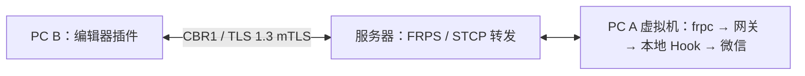

# ChatBridge

在 PC B 的 VS Code / Cursor 中，使用 PC A Windows 虚拟机里的个人微信。服务器仅转发端到端加密流量。固定应用栏与平台适配器为后续 QQ、feed、评论等独立应用保留扩展入口。

**当前版本：0.2.1，个人验证阶段。** 当前接入微信；QQ、小红书、bilibili 尚未实现。项目原创建者代码采用 MIT 许可。微信客户端不是开源软件，单独取得的 Hook 源码也未发现明确许可证；它们不包含在仓库或发布包中，详见 [第三方边界](docs/THIRD_PARTY.md)。



## 已有能力

- 会话、联系人、接入后历史、文字、图片、文件；语音接收、SILK → WAV、播放与保存，发送音频文件。
- 深色应用栏、整页聊天、按来源返回、当前 Webview 内的草稿与列表位置；自己的气泡使用灰色底与细线。
- 消息与附件 AES-256-GCM 加密落盘；Windows DPAPI / 编辑器 SecretStorage 保管密钥。
- 稳定命令编号、发送回执核对、断线续传、持久事件订阅；不确定发送只查账，不自动重复投递。
- 新消息优先采集、分库表目录缓存、通讯录分批刷新；正常入队不再显示顶部横幅，异常仍会提示。
- 虚拟机桌面启动、版本哈希校验、更新回退、私有备份与跨 Windows 用户的加密身份迁移工具。

锁屏收发要求 Windows 用户和微信已登录、虚拟机持续运行；睡眠、注销或关机不能实时收发。附件依赖微信后台下载。当前已验证 Hook 的附件发送限制为英文、数字文件名。语音原生发送、群聊完整实测、多日稳定性与部分平台消息类型仍有边界，见 [验证范围](docs/VALIDATION.md)。

## 从源码开始

```powershell
git clone https://github.com/NatsumeMoMo/ChatBridge.git
cd ChatBridge
py -3.11 -m pip install -e ./gateway pytest
py -3.11 -m pytest gateway tools -q
cd extension
npm ci --ignore-scripts
npm run build
npm test
npm run package
```

使用本地生成的 `extension/chatbridge-0.2.1.vsix`，或从 GitHub Actions 的 `chatbridge-vsix` 构建产物安装。Windows 部署使用 CPython 3.10+；CI 使用 Python 3.11 / Node 22。安装扩展后在设置中导入为当前 Windows 用户生成的 `.dpapi` 配对副本。

首次部署按 [完整部署步骤](docs/DEPLOYMENT.md) 准备服务器、专用 Windows VM、固定客户端 / 自构建 Hook、媒体环境与 PC B。配置示例全部使用占位值，不含作者机器地址和账号。

| 需要做什么 | 入口 |
| --- | --- |
| 搭建 FRPS 与核对服务器指纹 | `deploy/server/prepare.py`、`deploy/server/install.sh` |
| 构建 FRP | `tools/build-frp.ps1`；Linux 构建见部署文档 |
| 创建 / 迁移 / 重新导出身份 | `tools/enrollment.py` |
| 安装 VM 网关、frpc、任务与启动脚本 | `deploy/windows/Install.ps1` |
| 仅更新网关代码、保留数据与密钥 | `deploy/windows/Update.ps1` |
| 停止网关后制作一致备份 | `deploy/windows/Backup-Gateway.ps1` |
| 诊断整条加密链路，不发消息 | `node tools/doctor.cjs <配对副本> <Python路径>` |
| 更换服务器、VM、PC B 或 Hook | [替换与恢复手册](docs/RECOVERY.md) |

GitHub 保存软件和重建流程，不保存个人身份、历史、服务器私有配置或登录状态。请在仓库外保留加密的 `authority-backup.cbx`、备份口令，以及自己的 VM / 网关备份。仅有源码无法恢复丢失的数据密钥。

[架构与扩展接口](docs/ARCHITECTURE.md) · [通信协议](docs/PROTOCOL.md) · [第三方组件](docs/THIRD_PARTY.md) · [安全说明](SECURITY.md)
