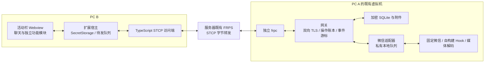

# 架构与扩展接口

## 数据路径与信任边界



真正的内层 TLS 会话由 B 的扩展宿主与虚拟机网关建立，中继和 frpc 都不能解密。外层 STCP 用于穿透；传输实现可替换，业务实体、请求与附件分块均不依赖 FRP。

0.1.1 插件在同一加密连接订阅持久事件。Store 提交后唤醒订阅者，响应与推送帧共用写锁；推送只负责减少等待，历史与断线恢复仍以持久游标为准。新命令提交后唤醒对应账号的发送任务，取消原先固定 3 秒的空闲等待。

文字气泡先显示“正在保存待发记录”，保存成功后进入待发 / 待回执状态；只有原生回执才能显示服务器已接受。回执把命令号关联到真实消息 ID，前端按编号合并；两个相同文案不会误合并。待发正文仍保存在 SecretStorage，保存失败保留草稿，不声称已发送。

消息更新只传必要的界面数据，未变化的通讯录不随每条消息重传。微信采集缓存已有消息表，使用 JOIN 一次获取发送者；未变会话每 30 秒回查修订，变更的消息编号即使在同一秒也立即采集。联系人完整刷新默认每 5 分钟，旧的不确定命令复用公共采集结果，不反复占用原生查询队列。

客户端证书、私钥保存在 B 的 SecretStorage；配对引导与管理 CA 在 B 用 CurrentUser DPAPI 加密。网关私钥与数据密钥在虚拟机用对应用户 DPAPI 包装。数据库正文、事件修订、命令、上传记录和附件使用 AES-256-GCM，每次写入生成随机 nonce，并用对象标签作为 AAD。SQLite 的对象类型、顺序与不透明 ID 仍是元数据，不能把整个文件称为完全无元数据。

平台客户端、Hook 与编解码器本身会在虚拟机产生缓存和内容日志；保留这些功能符合用户要求，目录 ACL 限制管理员与 SYSTEM。其安全边界是终端，不能防御已控制虚拟机或 B 用户会话的攻击者。

## 层次

| 层 | 职责 | 平台接入是否需要改动 |
| --- | --- | --- |
| transport | 连接、中继指纹、yamux 分片和流控 | 通常无需 |
| protocol / Client | CBR1 帧、TLS、请求关联、重连、背压 | 通常无需 |
| Gateway / Store | 设备授权、事件、历史、操作幂等、附件上传与下载 | 复用 |
| adapter | 登录状态、平台联系人与消息映射、发送、回执核对、媒体落地 | 新增平台实现 |
| app shell | 固定应用栏、连接状态、设置、应用实例生命周期 | 由平台清单生成入口 |
| messaging UI | 通讯录、会话、消息、附件、能力开关 | QQ 可直接复用；特殊消息新增渲染 |
| frontend module | feed、评论等独立交互 | 非聊天场景新增模块 |

## 账号、实体与能力

`platformId` 是平台类型，如 `wechat`；`accountId` 是带平台前缀的账号实例，如 `wechat:primary`。联系人 / 会话 / 消息 / 附件各有稳定 ID，原生 ID 只留在网关加密私有字段中。微信消息 ID 的输入包括账号、分库、会话、local_id，避免不同聊天重号。

适配器清单声明 `id / name / adapterVersion / modules / capabilities`。功能是否显示、是否允许提交均依据能力，而非平台名称。当前微信声明了文字、图片、文件、语音接收与音频文件发送，不声明原生语音发送、主动媒体下载或已验证原图。

当前基线的 `attachment.unicodeName=false` 表示附件发送暂限 ASCII 文件名。插件入队前提示，网关对新命令也执行校验，旧命令号仍可按原账本查询。未来通过 Unicode 候选验收后更新能力即可，不需要在通用界面添加平台名称分支。

账号分别保存接入时间与采集游标。每个账号拥有独立轮询与发送任务，一个平台登录失败不会阻止其它平台的循环。当前所有适配器仍位于同一网关进程；有本地崩溃风险的新平台应使用独立进程，通过本地受保护 IPC 暴露适配器，不把不可信原生库装进网关进程。

## 新增 QQ 这样的聊天适配器

实现 `chatbridge.adapters.Adapter`，包含：

```python
class QQ:
    account_id = 'qq:primary'
    manifest = {'id':'qq', 'name':'QQ', 'adapterVersion':'0.1.0',
                'modules':['messaging'],
                'capabilities':{'text.send':True, 'image.send':True, 'file.send':True}}

    def __init__(self, store, config): ...
    async def poll(self): ...
    async def send(self, command): ...
    async def reconcile(self, command): ...
    async def media(self, message): ...
```

通过包入口注册，无需修改工厂中的平台分支：

```toml
[project.entry-points."chatbridge.adapters"]
qq = "your_qq_package:QQ"
```

在网关 `adapters` 配置新增 `{"type":"qq", ...}`。工厂校验平台与账号命名，拒绝重复账号。插件通过 hello 清单自动获得平台；聊天模块无需另建连接。配置仅选择已安装入口，不允许任意 Python 导入字符串。

`poll()` 把平台数据写入 Store；`put` 对相同内容去重，正文变更追加事件，消息与媒体重试任务在同一 SQLite 事务提交。适配器不能把尚未验证的媒体标为 ready。

`send()` 执行前必须保存原生基线和提交信息；`reconcile()` 独立核对平台持久记录，唯一匹配且获得平台回执后才返回成功。原生调用超时后保持 uncertain，严禁在 reconcile 内再发一次。跨平台不能泛称 exactly-once；系统保证按同一命令号去重，并在不确定的副作用处停止自动重放。

## 新增 feed / 评论等独立模块

不要把动态、视频、收藏都转换成“消息”。平台在 `modules` 中声明如 `feed`，在 `module_operations` 中按 `(module, operation)` 注册 `ModuleOperation(capability, read_only, validate)`。

- 读取由 `module_read(module, operation, params)` 返回分页结果。
- 写入必须携带稳定 `commandId`，复用发送账本、send 与 reconcile；适配器根据请求中的 module / operation 分派。
- 参数由适配器校验后进入持久化；未注册操作或未声明能力直接拒绝。普通模块结果最多 110,000 UTF-8 字节，大结果应分页或使用附件通道。

前端通过扩展的公开 API 注册模块：

```ts
const bridge = await vscode.extensions.getExtension('chatbridge-local.chatbridge')!.activate();
context.subscriptions.push(bridge.registerModule({
  id: 'feed',
  async open(ctx) {
    const page = await ctx.invoke('list', {after: null});
    // 在自己的安全 Webview 中展示 page。
  }
}));
```

0.2.0 固定应用栏按平台清单生成入口。聊天应用存在额外模块时，列表底部显示模块入口；纯模块应用使用独立功能入口页。独立界面获得限定账号和模块的 invoke 入口，不获得 TLS 私钥。所有新 Webview 仍须使用 CSP、文本安全渲染、明确的用户动作与能力校验。写操作的命令号须在提交前持久化；重连后查账，不临时生成另一个命令号。

目前只交付 messaging 界面和模块注册入口。小红书 / bilibili 的鉴权、接口、数据映射、功能界面及各自规则仍需单独适配；现有扩展点减少公共设施重复建设，不能替代平台适配工作。

## 应用页面与导航

`media/workbench.js` 负责应用栏、连接设置、增量状态与消息分派。`media/messaging.js` 是微信的独立页面工厂；`media/icons.js` 提供本地 SVG、基础 DOM 工具与页面注册表。应用根节点挂载到 `appViewport`，切换时保留各自实例；新增平台不会共享微信的搜索、草稿或路由。仅网关已声明的平台会出现在栏中。

打包在扩展中的应用代码可在 `workbench.js` 启动前通过 `window.ChatBridgeApps.register(platformId, factory)` 注册专属页面。工厂收到 `(manifest, {send, showSettings})`，返回 `{element, update(state), handleMessage?(message), activate?(), deactivate?(), dispose?()}`。切换应用时先发送 `selectPlatform`，再激活页面；页面的宿主请求仍经过固定 receive 分派与网关能力校验。注册表只接收扩展自身的可信脚本，不加载网络代码，也不向页面暴露 TLS 凭据。

应用的初始化和生命周期调用均有异常边界。失败时仅替换当前应用页并提供重试，固定栏与设置继续工作；应用名称或模块清单变化时重建对应实例。已经在网关保存的消息和待发账本不受页面重建影响。

未注册专属页面、但声明 `messaging` 的平台可复用聊天工厂；纯模块应用落到功能入口页。QQ 可以复用聊天页面或注册自己的页面；小红书、bilibili 可独立组织 feed、收藏、评论等界面。新图标需加入本地 SVG 常量和应用栏图标选择；不存在接入仅靠添加图标就自动完成的承诺。

微信列表分为会话与联系人，各自保留查询和滚动位置。打开对话后只显示聊天页及输入区，底部列表导航隐藏，固定应用栏保留。返回恢复进入对话时的列表。每次页面选择携带请求号，宿主在状态中回传 `selectionRequest`；迟到的响应不会把已返回的页面重新打开，也不会把旧会话内容显示到新目标。宿主公开 `openConversation` 没有页面请求号，仍可主动打开会话。

正文与名称始终按文本渲染；SVG 标记仅来自源码常量。聊天草稿、搜索和媒体预览缓存仅保留在 Webview 内存，不写入 Webview 持久状态；待发记录仍由 SecretStorage 保存。消息 DOM 复用已存在的媒体控件，未变的语音节点不会因其他消息到来而移出文档。
